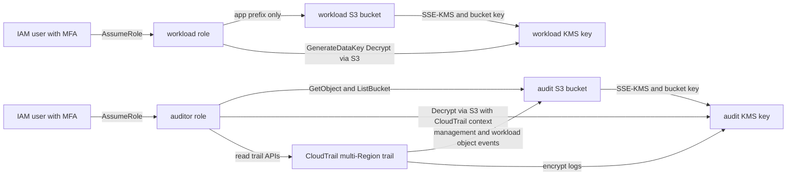

# Architecture

Draft, pending independent fact-check. Nothing in this document was observed in a live AWS account.

## Boundary

One account, one home Region, two buckets, two single-Region symmetric customer managed keys, one multi-Region CloudTrail trail for management events and workload bucket object data events, and two IAM roles. The trail is not an organization trail. There is no VPC, no compute, and no second account.

The workload role's identity policy does not name the audit bucket. The audit key policy does not name the workload role. The workload key policy does not name `cloudtrail.amazonaws.com`.

## Why these resources

S3 security guidance recommends Block Public Access, disabling ACLs with bucket-owner-enforced ownership, versioning, HTTPS, and SSE-KMS or SSE-S3. This draft uses SSE-KMS with a customer managed key and an S3 Bucket Key on each bucket. SSE-S3 is the service default; it is not the control this draft plans.

CloudTrail's published bucket policy allows `cloudtrail.amazonaws.com` to call `s3:GetBucketAcl` and `s3:PutObject` when `aws:SourceArn` is the trail ARN, and requires `bucket-owner-full-control` on the put. The audit bucket policy follows that example and adds the same TLS deny used on the workload bucket. The object prefix is `cloudtrail/AWSLogs/<account-id>/*`.

The trail is multi-Region, includes global service events, enables log file validation, and sets `is_organization_trail` to false. CloudTrail's concepts page describes a multi-Region trail as recording events in all enabled Regions and delivering them to one bucket, and says a multi-Region trail can be modified only in its home Region. The CreateTrail API says `IncludeGlobalServiceEvents` delivers global service events when the trail is multi-Region or when its home Region is the partition leader. Log file validation's default in that API is false, so the Terraform sets it to true explicitly. The same page says enabling validation does not itself validate the files.

KMS automatic rotation is enabled with a 365 day period, which is the default period described on the KMS rotation page when `RotationPeriodInDays` is omitted. The keys are symmetric `ENCRYPT_DECRYPT` keys because that page limits automatic rotation to symmetric keys with AWS KMS key material. `deletion_window_in_days` is 30, the top of the 7-30 day waiting period described on the delete-key page. `multi_region` is false so this draft does not create replica keys.

IAM roles trust IAM users in the same account and require `aws:MultiFactorAuthPresent`. The workload role can list only the `app/` prefix and can read, write, and delete objects under `app/*`. `s3:PutObject` also requires the `aws:kms` encryption header on the workload role. The bucket policies deny `PutObject` unless that header is `aws:kms`. A request that omits the header is denied before default encryption applies. On the audit bucket, `StringNotEqualsIfExists` excludes CloudTrail from that deny. An IAM caller has no `aws:PrincipalServiceName`, so an IAM upload that sends `AES256` is denied. CloudTrail may send `aws:kms` or `AES256`. The CloudTrail security best-practices page shows that condition when SSE-KMS and log file validation are used, and the example assumes CloudTrail sends one of those two values. The audit bucket denies `s3:DeleteObject` and `s3:DeleteObjectVersion` for every principal. The role does not receive `s3:DeleteObjectVersion`. The auditor role can read objects under the `cloudtrail/` prefix and list only that prefix, plus a fixed set of CloudTrail read actions. `LookupEvents`, `DescribeTrails`, and `ListTrails` are allowed on `Resource "*"` because this draft treats them as account-scoped reads. AWS's service reference JSON for CloudTrail, read 13 November 2026, lists no resource types for those three actions.

## Decisions that keep the boundary small

| Topic | Decision |
| --- | --- |
| Data events | On for `AWS::S3::Object` in the workload bucket only, since 13 November 2026. Not on the audit bucket, which would log its own deliveries. Published price: $0.10 per 100,000 data events delivered. |
| Insights, Lake, CloudWatch Logs, EventBridge | Not in the stack. |
| S3 server access logs | Not configured. They are a separate log stream from CloudTrail. |
| Object Lock and MFA Delete | Object Lock is opt-in on the audit bucket (`audit_object_lock_mode`, default `OFF`). MFA Delete is off because it cannot be used with lifecycle. With the default, this is not WORM storage. |
| VPC endpoint | Not included. There is no compute in the boundary. A bucket policy that required `aws:SourceVpce` would also have to exempt CloudTrail or delivery would fail. |
| Organization trail and SCPs | Out of scope. One plan cannot state tenant-wide policy. |
| Account-level Block Public Access | Set by `terraform/account.tf`, all four settings. Affects every bucket in the account. |
| SSE-C | Not configured here. The S3 security best-practices page describes an April 2026 default that disables SSE-C on new general purpose buckets. This Terraform does not call that API. |
| Bucket namespace | Names are in the shared global namespace and include the account id. The same page recommends the account regional namespace. This draft does not use it. |
| `recursive_logging` | Not set. Provider 5.100.0 rejected the argument. The CreateTrail API default is true. |

## Dependencies the plan encodes

The trail depends on the audit bucket policy and the audit KMS key. Bucket policies depend on the public access blocks. Lifecycle configurations depend on versioning. Child S3 resources reference the bucket `bucket` attribute, which is the name, because provider 5.100.0 marks `id` as known after apply even when the name is set. Alias targets and alias ARNs remain known after apply; the checker therefore reports those links as unknown on a real plan.

## Provider authentication

`terraform/providers.tf` hard-codes a non-secret placeholder and skips credential and account lookup. A mistaken apply cannot fall through to ambient credentials while that block stays as written. Replacing it is a separate change and was not done here.
