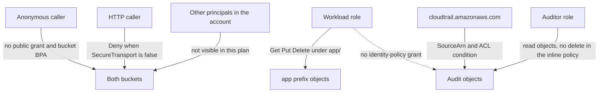

# Threat model

Draft, pending independent fact-check. Controls below are planned values. They were not observed against a live account.

## What this boundary is trying to limit

- Anonymous reads and writes of either bucket, using all four bucket Block Public Access settings plus policies that do not grant `Principal "*"` except for an explicit deny.
- Bucket requests that arrive with `aws:SecureTransport` false. The S3 example policy page shows a deny of `s3:*` on the bucket and object ARNs for that condition. Both buckets use that shape.
- `PutObject` that omits `x-amz-server-side-encryption`, or sends a value other than `aws:kms`. The check is `StringNotEquals`, so a missing header is denied before default encryption applies. CloudTrail may send `aws:kms` or `AES256`. An IAM caller who sends `AES256` to the audit bucket is denied, because `aws:PrincipalServiceName` is absent and the deny uses `StringNotEqualsIfExists`.
- Workload access outside `app/`, and workload access to the audit bucket, by omitting those resources from the workload identity policy.
- A confused deputy on the log bucket. The CloudTrail bucket-policy page says to add `aws:SourceArn` so CloudTrail writes only for a specific trail. The planned policy uses the trail ARN, not only the account.
- Use of the audit key by the workload role, by keeping that role out of the audit key policy and using a different key from the workload bucket.
- Quiet weakening of trail settings that have insecure API defaults. CreateTrail defaults log file validation and multi-Region to false. The plan sets both to true and sets `is_organization_trail` to false so this stack does not claim to be an organization trail.

## What still breaks the boundary

- Any principal outside these two roles. The key policies allow this account's root `kms:*`, which is the delegation pattern in the Terraform AWS provider's key example. Any other IAM policy in the account that grants `kms:*` can use the keys. This checker cannot see those policies.
- Bucket-level Block Public Access can be changed by a principal who can change the bucket policy. The Block Public Access page says account-level `BlockPublicPolicy` is the stronger control because a bucket policy can otherwise be edited to turn the bucket setting off. This stack does not set the account control.
- The audit bucket policy denies `s3:DeleteObject` and `s3:DeleteObjectVersion` for every principal. A principal who can change that policy can remove the deny. S3 Lifecycle expiration still removes objects, because lifecycle does not call `DeleteObject`. Object Lock is explicitly off, so these logs are not WORM. The S3 security page says Object Lock can help protect CloudTrail logs. This draft does not enable it, because compliance retention can outlive a study teardown and was not apply-tested. The workload role can still delete current objects under `app/`.
- Lifecycle expiration deletes current audit objects after the retention window (default 365 days) and noncurrent versions sooner. That is deliberate destruction of log objects, not immutability.
- Log file validation can show that a delivered file changed or that a digest chain broke. The validation page says you still have to run validation. This CLI does not. It also says disabling validation breaks the digest chain for the gap. The plan leaves validation on.
- KMS deletion is irreversible for symmetric ciphertext once the waiting period ends. During the wait, the delete-key page says the key cannot be used for cryptographic operations. A scheduled deletion therefore makes existing objects unreadable before the key is gone. The price page says a key pending deletion is not charged, and canceling deletion resumes charges as though it was never scheduled.
- CloudTrail retries a misconfigured trail for 30 days and those attempted deliveries are billed. The bucket-policy page says to delete the trail to stop that.
- Deleting a bucket in the shared global namespace lets another account reuse the name. The S3 security page warns about that and recommends not deleting the bucket, or using the account regional namespace. This draft uses the shared namespace.
- The workload role can delete current objects under `app/`. Versioning keeps a noncurrent version until the 30 day noncurrent lifecycle. That is not a backup.
- MFA on `AssumeRole` checks the call into these roles. It does not prove how the trusted user authenticated earlier. The trust policy does not allow role principals, because role-chain MFA was not validated.
- A later plan can remove these resources. The checker only sees the file it is given. It does not enforce anything at apply time, and this draft has no apply.

## Out of scope on purpose

Network paths, organization guardrails, detective services, object-level data events, server access logs, and digest validation jobs. They are listed in the checker output under `coverage.not_assessed` so a pass cannot be read as complete coverage.
